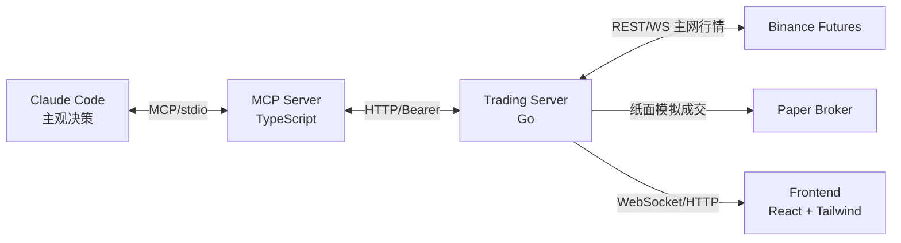

# MCP Trade

基于 Claude Code + MCP 协议的 **AI 主观交易系统**。AI 通过价格行为（YTC / 裸 K 线）等主观方法做决策，交易执行、仓位计算与风控由 Go 服务端强制执行。

> 交易有风险。AI 决策不保证盈利，任何策略都可能亏损。先用纸面模式验证，再考虑实盘。

## 架构



关键设计：

- **行情与交易场所解耦**：行情始终来自主网 `fapi.binance.com`；交易可以跑在 `paper` / `testnet` / `mainnet`。这样纸面与测试网验证看到的都是真实价格。
- **风控在服务端**：止损强制性、单笔 R 风险、总敞口、持仓数、日/周亏损、杠杆与保证金检查都在 Go 服务端执行，AI 无法绕过。
- **Plan/Apply 闸门**：预览返回服务端生成的、2 分钟有效、单次使用的 `plan_id`；确认时参数不可篡改。
- **自动保护单**：入场成交后立即挂 `STOP_MARKET(closePosition=true)`，可选再挂 `TAKE_PROFIT_MARKET`。止损单下不出去时，服务端会立即反向平掉入场仓。
- **持仓级交易日志**：一笔交易 = 一个持仓生命周期，记录入场/出场、止损/止盈、R 倍数、手续费、setup 标签，而不是把每张订单都当成一笔交易。

## 快速开始

### 1. 依赖

- Go 1.25+
- Node.js 22+
- Binance USDⓈ-M Futures API Key

### 2. 配置

```bash
git clone https://github.com/Ye-Yu-Mo/mcp_trade.git
cd mcp_trade

cp trading-server/.env.example trading-server/.env
# 编辑 .env：填入 BINANCE_API_KEY / BINANCE_API_SECRET / API_TOKEN
```

推荐先生成随机 token：

```bash
openssl rand -hex 24
```

### 3. 构建

```bash
# Go 服务
cd trading-server
go build -o bin/trade-server ./cmd/server/

# MCP Server
cd ../mcp-server
npm install
npm run build

# 前端
cd ../frontend
npm install
npm run build
rm -rf ../trading-server/frontend-dist
cp -R dist ../trading-server/frontend-dist
```

### 4. 启动

```bash
cd trading-server
set -a && . ./.env && set +a
go run ./cmd/server
```

看板：<http://127.0.0.1:8877/>，输入 `.env` 里的 `API_TOKEN`。

### 5. 配置 MCP

项目根目录的 `.mcp.json`：

```json
{
  "mcpServers": {
    "mcp-trade": {
      "type": "stdio",
      "command": "node",
      "args": ["/path/to/mcp_trade/mcp-server/dist/index.js"],
      "env": {
        "TRADING_SERVER_URL": "http://127.0.0.1:8877",
        "TRADING_API_TOKEN": "your_secret_token_here"
      }
    }
  }
}
```

重启 Claude Code 后，`mcp-trade` 工具才会加载。

## 运行模式

通过 `TRADE_ENV` 选择：

| 值 | 交易场所 | 行情 | 用途 |
|---|---|---|---|
| `paper` | 本地模拟账户 | 主网真实行情 | **推荐的第一阶段**：验证策略与执行链路 |
| `testnet` | 币安测试网 | 主网真实行情 | 验证真实下单/条件单 API |
| `mainnet` | 币安主网 | 主网真实行情 | 实盘；先用小资金 |

### 纸面模式

```bash
TRADE_ENV=paper
PAPER_BALANCE=33.12
PAPER_STATE_PATH=data/paper_state.json
```

- 市价单按最新价 ± 2 bps 滑点成交；taker 0.05%，maker 0.02%。
- 逐仓保证金模型；后台每秒检查止损/止盈与强平。
- 状态持久化到 `data/paper_state.json`，重启后可恢复持仓与订单。
- 交易记录写入 DuckDB，`trade.performance` 直接可用。
- **不模拟资金费率**（短周期验证影响较小，长持有时需注意）。

### 实盘 / 测试网

```bash
TRADE_ENV=mainnet
SETUP_ACCOUNT=false   # 默认不改账户设置
```

`SETUP_ACCOUNT=false` 是刻意的安全默认值：服务启动时**不会**修改持仓模式、保证金模式或杠杆。需要初始化账户时再显式设为 `true`（目前会把 BTC/ETH/SOL 设为逐仓 + `MAX_LEVERAGE`，并切换到单向持仓）。

实盘建议：

- API Key 只开合约权限，**关闭提现**，加 IP 白名单。
- 先跑纸面 ≥50 笔，期望值 > 0.2R、Profit Factor > 1.3、最大回撤 < 10R，再上实盘。
- 小账户（20–50 USDT）注意交易所最小名义价值：BTC 50、ETH 20、SOL 5 USDT。BTC 往往需要更高杠杆或更紧止损才能满足最小名义价值。

## 风控体系（服务端强制）

| 检查 | 默认 | 拒绝码 |
|---|---|---|
| 强制止损 | 每笔开仓必须带 `stop_price`，且方向正确 | `RISK_STOP_REQUIRED` / `RISK_STOP_SIDE` |
| 单笔风险 | 权益的 1%（`RISK_PER_TRADE_PCT=0.01`） | `RISK_STOP_LOSS` |
| 总开仓风险 | 权益的 3%（`MAX_TOTAL_RISK_PCT=0.03`） | `RISK_TOTAL_RISK` |
| 最大持仓数 | 2（`MAX_POSITIONS=2`） | `RISK_MAX_POSITIONS` |
| 杠杆上限 | 5x（`MAX_LEVERAGE=5`） | `RISK_LEVERAGE` |
| 单笔名义价值 | ≤ 1.5x 权益（`MAX_NOTIONAL_PCT=1.5`） | `RISK_MAX_NOTIONAL` |
| 保证金 | 不超过可用余额 | `RISK_MARGIN` |
| 最小名义价值 | 来自 `exchangeInfo`，不硬编码 | `RISK_MIN_NOTIONAL` |
| 日亏损 | 权益的 3%（`DAILY_LOSS_PCT=0.03`） | `RISK_DAILY_LOSS` |
| 周亏损 | 权益的 8%（`WEEKLY_LOSS_PCT=0.08`） | `RISK_WEEKLY_LOSS` |
| 减仓/平仓 | **永远允许**，不受日/周亏损限制 | — |

日/周亏损以**当天/本周起始权益**为基准计算，包含未实现盈亏和部分平仓的已实现亏损，而不是只加总已关闭交易。

仓位计算两种方式：

- `quantity`：直接给数量，服务端校验风险不超过上限。
- `risk_pct`：只给风险百分比和止损价，服务端按 `权益 × risk_pct / |入场-止损|` 计算数量，并向下取整到 step size。

### 限价挂单过期（`expire_minutes`）

限价开仓可以带 `expire_minutes`（分钟，0–10080，留空 = GTC 一直有效）：

- **实盘**：转成交易所原生的 `timeInForce=GTD` + `goodTillDate`，到期由币安自己撤单，服务进程挂了也照样生效。
- **纸面**：`paperOrder.expire_at` 落盘，broker 每秒扫描，到点把订单置为 `EXPIRED`。
- 到期/手动撤单时，**为该入场单准备的止损/止盈会一起撤掉**——否则它们会留在盘上，等下一个不相关的仓位出现时突然触发。

只对 `LIMIT` 开仓有效；市价单立即成交、保护单必须活到仓位结束，所以服务端会直接拒绝这两种用法。

## MCP 工具

### 行情 `market.*`
| 工具 | 说明 |
|---|---|
| `market.klines` | K 线（支持多币种/多周期） |
| `market.ticker` / `market.price` | 最新价 |
| `market.orderbook` | 订单簿 |
| `market.watch` | 缓存快照 + 已触发提醒 |
| `market.scanner` | 24h 成交量扫描 |
| `market.funding` | 当前资金费率（`premiumIndex`） |
| `market.oi` | 未平仓合约 |
| `market.atr` | ATR |
| `market.candle_info` | 当前 K 线剩余时间 |
| `market.alerts` | 设置/查询/删除价格提醒 |
| `market.calendar` | 经济日历（静态近似，见限制） |
| `market.monitor` | 一次调用汇总权益、持仓、已触发/活跃提醒 |

### 账户 `account.*`
| 工具 | 说明 |
|---|---|
| `account.balance` | 余额 |
| `account.positions` | 持仓 |

### 订单 `order.*`
| 工具 | 说明 |
|---|---|
| `order.place` | 两步下单：预览 → `confirm=true + plan_id` 执行；自动挂止损/止盈；`expire_minutes` 让限价挂单到点自动撤销 |
| `order.close` | 市价平仓（可部分），同时撤销保护单 |
| `order.cancel` | 撤单 |
| `order.list` | 挂单列表 |
| `order.status` | 订单详情 |
| `order.modify_stop` | 先下新止损、成功后再撤旧止损 |
| `order.oco` | 已弃用：币安合约无 OCO，用 `order.place` 的 `take_profit_price` |

### 交易日志 `trade.*`
| 工具 | 说明 |
|---|---|
| `trade.history` | 持仓级交易记录（OPEN/CLOSED、R、setup） |
| `trade.journal` / `trade.journal_list` | 经验记录 |
| `trade.performance` | 胜率、盈亏比、期望 R、最大回撤（只统计 CLOSED） |

## API

所有 `/api/v1/*` 需要 `Authorization: Bearer <API_TOKEN>`。

| 方法 | 路径 | 说明 |
|---|---|---|
| GET | `/health` | 健康检查（公开，含 `paper` 标记） |
| GET | `/api/v1/market/klines` | K 线 |
| GET | `/api/v1/market/ticker` | 最新价 |
| GET | `/api/v1/market/orderbook` | 深度 |
| GET | `/api/v1/market/watch` | 行情快照 |
| GET | `/api/v1/market/scanner` | 市场扫描 |
| GET | `/api/v1/market/funding` | 资金费率 |
| GET | `/api/v1/market/oi` | 未平仓合约 |
| GET | `/api/v1/market/atr` | ATR |
| GET | `/api/v1/market/candle_info` | K 线时间 |
| GET | `/api/v1/market/calendar` | 经济日历 |
| POST/GET/DELETE | `/api/v1/market/alert` | 价格提醒 |
| GET | `/api/v1/account/balance` | 余额 |
| GET | `/api/v1/account/positions` | 持仓 |
| POST | `/api/v1/order/place` | 预览/下单（Plan/Apply，支持 `expire_minutes`） |
| POST | `/api/v1/order/close` | 市价平仓 |
| POST | `/api/v1/order/modify_stop` | 修改止损 |
| DELETE | `/api/v1/order/cancel` | 撤单 |
| GET | `/api/v1/order/list` | 挂单 |
| GET | `/api/v1/order/status` | 订单详情 |
| GET | `/api/v1/trade/history` | 交易历史 |
| POST/GET | `/api/v1/trade/journal` | 交易日志 |
| GET | `/api/v1/trade/performance` | 绩效 |

## 环境变量

| 变量 | 默认 | 说明 |
|---|---|---|
| `TRADE_ENV` | `testnet` | `paper` / `testnet` / `mainnet` |
| `BINANCE_API_KEY` | 必填 | 币安 API Key |
| `BINANCE_API_SECRET` | 必填 | 币安 API Secret |
| `API_TOKEN` | 必填 | 前后端/MCP 鉴权 token |
| `SERVER_PORT` | `8877` | HTTP 端口 |
| `BIND_ADDR` | `127.0.0.1` | 绑定地址；默认只监听本机，通过 SSH 隧道访问 |
| `DB_PATH` | `data/trade.duckdb` | DuckDB 路径 |
| `MARKET_DATA_URL` | `https://fapi.binance.com` | 行情源（保持主网） |
| `SETUP_ACCOUNT` | `false` | 是否在启动时修改账户设置 |
| `PAPER_BALANCE` | `33.12` | 纸面初始权益 |
| `PAPER_STATE_PATH` | `data/paper_state.json` | 纸面状态文件 |
| `RISK_PER_TRADE_PCT` | `0.01` | 单笔风险占权益比例 |
| `MAX_TOTAL_RISK_PCT` | `0.03` | 总开仓风险上限 |
| `MAX_POSITIONS` | `2` | 最大持仓数 |
| `MAX_LEVERAGE` | `5` | 杠杆上限 |
| `MAX_NOTIONAL_PCT` | `1.5` | 单笔名义价值上限（权益倍数），限制跳空损失 |
| `DAILY_LOSS_PCT` | `0.03` | 日亏损熔断 |
| `WEEKLY_LOSS_PCT` | `0.08` | 周亏损熔断 |

## 已知限制

- **实盘条件单走 Algo Order API**：Binance 当前已不再接受普通 `/fapi/v1/order` 的 STOP/TAKE_PROFIT 类型，必须使用 `/fapi/v1/algoOrder`（`algoType=CONDITIONAL`）。本系统已适配，并通过用户数据流的 `ALGO_UPDATE` 跟踪触发/成交。
- **实盘限价开仓暂不支持**：限价单成交前无法安全地由服务端挂保护单，因此实盘开仓必须用 `MARKET`；纸面模式支持限价。
- **部分平仓后的交易记录**：交易行会保持 `OPEN`，直到仓位完全平掉才写入最终 R/PnL；但日/周亏损闸门使用权益基线，部分亏损会立即计入风控。
- **OCO 不存在**：Binance USDⓈ-M Futures 没有 OCO；用入场 + 独立止损/止盈实现括号单。
- **资金费率未计入纸面盈亏**。
- **经济日历是静态近似**：只包含未来 30 天的 NFP/CPI/FOMC 等近似日期，不应当作精确事件时间。
- **提醒不主动推送**：服务端每 3 秒检测，Claude 需要调用 `market.monitor` / `market.alerts` 才能看到；不运行会话时不会有 AI 决策。
- **单一进程**：DuckDB 单写者，不要同时启动多个 trading-server。
- **实盘需要单向持仓**：启动时会检测，检测到双向持仓会拒绝启动；可用 `SETUP_ACCOUNT=true` 初始化。

## VPS 24/7 部署（当前）

交易服务器已部署到常开 VPS，两个 systemd 服务：

| 服务 | 端口 | 模式 | 用途 |
|---|---|---|---|
| `mcp-trade` | 8877 | mainnet | 实盘执行；当前空仓，等待策略验证后才使用 |
| `mcp-trade-paper` | 8878 | paper | 24/7 纸面验证；模拟止损/止盈由 VPS 持续运行 |
| `mcp-trade-paper-5m` | 8879 | paper | 5m 策略独立纸面账户 |

两者都只绑定 `127.0.0.1`，通过 SSH 隧道访问：

```bash
ssh -N -L 8877:127.0.0.1:8877 root@your-vps
ssh -N -L 8878:127.0.0.1:8878 root@your-vps
```

### 隧道自动维护（macOS）

手工 `ssh -N -L` 会断，而且最坑的坏法是**进程活着但转发已经死了**——所有 MCP 工具直接 `fetch failed`。所以做了两层：

1. `~/Library/LaunchAgents/com.jasxu.mcp-trade-tunnel.plist`
   `ssh -N` 同时转发 8877/8878/8879，带 `ExitOnForwardFailure=yes`、`ServerAliveInterval=30`、`KeepAlive`。端口被占就失败退出，让 launchd 重启。
2. `~/Library/LaunchAgents/com.jasxu.mcp-trade-tunnel-watch.plist`
   每 120 秒跑 `scripts/trade-tunnel-watch.sh`：用 `nc -z` 检查三个端口是否**真的在监听**，发现死端口就 `launchctl kickstart -k` 重启隧道。

安装：

```bash
cp ~/Library/LaunchAgents/com.jasxu.mcp-trade-tunnel*.plist ~/Library/LaunchAgents/
launchctl bootstrap gui/$(id -u) ~/Library/LaunchAgents/com.jasxu.mcp-trade-tunnel.plist
launchctl bootstrap gui/$(id -u) ~/Library/LaunchAgents/com.jasxu.mcp-trade-tunnel-watch.plist
```

如果更想用 crontab（launchd 之外的第二选择，定时器语义相同）：

```cron
*/2 * * * * /Users/jasxu/Documents/m_trade/scripts/trade-tunnel-watch.sh
```

> 合盖休眠时两者都不会运行，唤醒后 launchd 会立刻拉起隧道；cron 要等下一个 2 分钟周期。

项目 `.mcp.json` 同时配置：

- `mcp-trade` → `http://127.0.0.1:8877`（实盘，谨慎）
- `mcp-trade-paper` → `http://127.0.0.1:8878`（纸面验证，优先使用）

**合盖/离线时**：

- 实盘：交易所侧 Algo STOP/TP 仍然有效；AI 不能开新仓/调止损。
- 纸面：VPS 上的 paper 实例继续模拟止损/止盈，不会因为本机合盖而停止。

## 运维

```bash
# 健康检查
curl http://127.0.0.1:8877/health   # 实盘
curl http://127.0.0.1:8878/health   # 纸面

# VPS 服务
systemctl status mcp-trade
systemctl status mcp-trade-paper
journalctl -u mcp-trade -n 50
tail -f /var/log/trade-server.log
tail -f /var/log/trade-server-paper.log

# 运行测试
cd trading-server && go test ./...
cd mcp-server && npm run build
```

## 开发路线

- [x] 行情解析修复（bookTicker 卖一价被卖一量覆盖）
- [x] 条件单迁移到 Binance Algo Order API（`/fapi/v1/algoOrder`）
- [x] R 风控 + 强制止损 + 自动保护单
- [x] 单笔名义价值上限（1.5x 权益，限制跳空损失）
- [x] 纸面盘 + 持仓级交易日志
- [x] 前端看板改版
- [x] 市价单 RESULT 回执 + 成交确认回退
- [x] 部分平仓保留保护单
- [x] 启动时对账 OPEN 交易与交易所持仓
- [x] 日/周亏损改为权益基线（含未实现）
- [x] 限价挂单过期（实盘 GTD / 纸面扫描），到期连带撤掉括号保护单
- [x] 本地隧道自愈（launchd + 端口级看门狗）
- [ ] 服务端事件流（提醒/止损接近/资金费率）与主动通知
- [ ] 回测/重放 + 数据记录
- [ ] 实盘限价开仓的成交后自动保护
- [ ] 真实经济日历 API
- [ ] 多策略标签绩效对比
